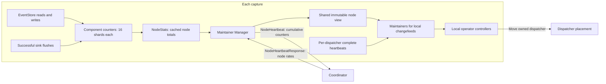

# Shared Node Resource View for Dispatcher Balancing

## 1. Problem and decision

Equal dispatcher counts do not imply equal node load. Consider nine tables
distributed as three dispatchers per capture. If three hot tables happen to
share one capture, count balancing sees `3 / 3 / 3`, while traffic is concentrated
on that capture. This is especially visible when each table remains an
indivisible dispatcher. A per-changefeed view also misses work from other
changefeeds on the same node.

The Coordinator publishes a shared view of total node resource usage. Each
Maintainer combines that view with the traffic and placement of its own
dispatchers, chooses a source and destination, and creates its own move
operator. There is no Coordinator request or approval for each migration.
Subsequent node samples report the actual effect of accepted moves.

The initial resource vector contains EventStore write traffic, EventStore read
traffic, and aggregate sink traffic. Sink traffic estimates the benefit of
moving a dispatcher. EventStore traffic constrains destination selection:
subscriptions can be shared or remote, so moving a dispatcher does not imply
that the corresponding EventStore work immediately moves with it.

### Goals

- Improve placement even when dispatcher counts are already balanced.
- Include other changefeeds' work when evaluating node load.
- Keep dispatcher ownership and migration decisions local to each Maintainer.
- Reuse one sampling and publication path for additional traffic resources.
- Reduce oscillation while retaining count balancing and mixed-version progress.

### Scope

The new decision path operates on the default replication group, including
whole-table dispatchers. Existing split-group balancing remains separate.
Basic scheduling, drain scheduling, operator safety, and downstream write
admission retain their existing responsibilities.

The current design does not relocate EventStore subscriptions independently,
measure physical disk utilization, or balance CPU and memory. It assumes
comparable node capacity and provides a feedback heuristic rather than a global
optimizer or a bounded convergence time.

## 2. Ownership and data flow



The next resource samples and dispatcher heartbeats reflect the new placement.
The arrows represent logical responsibilities; the Coordinator itself also
runs on a capture.

| Owner | State and responsibility |
| --- | --- |
| Resource producers | Component-owned cumulative counters; writers select a shard once and update it at the measurement boundary. |
| `NodeStats` | One capture-owned registry, integer aggregation baselines, node totals, and a cached sample; retains retired components' contributions. |
| Maintainer Manager | Reports cached node totals even when no changefeed Maintainer is hosted locally; validates Coordinator responses. |
| Coordinator | Stores counter baselines and smoothed rates by capture, then publishes node totals and availability. |
| `NodeLoadTracker` | Shares one immutable view among local Maintainers and their normal/redo span controllers. |
| Maintainer | Owns its changefeed's dispatcher details and temporary migration projections. |
| Operator controller | Admits and executes moves using the existing operator lifecycle. |

### Publication membership and local eligibility

The Coordinator's publication set `P` is its bootstrapper's `GetAllNodeIDs()`:
the captures currently tracked by membership. It can include a capture still
bootstrapping or being drained; membership does not mean that a capture is a
valid migration destination. The common resource set and Coordinator-side
completeness/freshness checks cover all of `P` until a member is removed.

Each Maintainer constructs its local eligible set `E` from the node watcher's
`GetAliveNodes()`, with the active dispatcher-drain target removed. Resource
averages are computed over `E`, and the local tracker requires a consistent
vector for every member of `E`. Being in `E` does not mean that a node has
passed the per-move load constraints. Regular balancing also pauses during an
active drain and its existing cooldown before these decisions run.

Local exclusion does not remove a capture from `P`. A member without supported
load reporting can therefore downgrade the published view even if it would
not be a local target. An unobserved member makes support unconfirmed and
selects `LOAD_UNSUPPORTED`; once all members report support, an unusable or
stale sample selects `LOAD_INCOMPLETE`.

Node observations are asynchronously collected. A published cluster view is not
an atomic measurement of all nodes at one instant. Local projections are not
reservations and are not published back to the Coordinator. Other Maintainers
continue using observations until the next accepted sample.

## 3. Resource model and measurement

`pkg/scheduler/resource.Load` maps `ResourceType` to a nonnegative rate. Each
dimension is evaluated independently against its own cluster average; raw byte
rates from different pipeline stages are never added into one traffic score.
`load.go` defines types and wire conversions. `stats.go` owns local collection;
there are no exported package-global byte counters.

| Resource type | Measurement point | Meaning |
| --- | --- | --- |
| `RESOURCE_SINK` | `TableProgress` after a successful DML flush | Flushed event size across all changefeeds and modes on the process, in the same event-size units as dispatcher traffic reports. |
| `RESOURCE_EVENT_STORE_WRITE` | Successful `writeEvents` batch commit | Encoded Pebble batch bytes, including batch framing. |
| `RESOURCE_EVENT_STORE_READ` | Iterator visits before decryption and decompression | Stored encoded key and value bytes, including records subsequently filtered by a shared subscription's span. |

EventStore reads include cache hits and repeated scans. These are logical
access counters, not physical device IO, WAL, or compaction measurements. Sink
event-size accounting is also distinct from downstream protocol or socket
bytes. Existing Prometheus byte metrics can have different accounting
boundaries and should not be substituted without checking their definitions.

### Capture ownership and component shards

Server creates one `NodeStats` per capture in `setPreServices` and registers it
as `NodeResourceStats` in the existing application service context. It is passed
explicitly to EventStore; Maintainer Manager and DispatcherManager obtain the
same instance during construction. Hot paths retain their recorder pointers
instead of looking up a service on each event.

Each DispatcherManager registers one sink `Counter`, shared by its normal and
redo dispatchers. EventStore registers separate write and read counters. Each
counter has 16 fixed shards. A write worker, dispatcher, or iterator chooses a
recorder once at creation; writers can share a shard when their count exceeds
16. Shard padding reduces contention between independent shard updates on common
64-byte-cache-line platforms.

The node registry contains component counters, not every dispatcher or
short-lived iterator. EventStore reads first accumulate in the iterator's own
goroutine, then update its recorder at 64 KiB, when `Next` returns, or at close.
Filtered records can be combined without delaying a successfully returned row
until iterator shutdown. Writes record the committed batch size; sink updates
occur in the existing successful-flush callback.

### On-demand aggregation and retirement

For component `c`, shard `s`, and resource `r`, local aggregation uses integer
deltas:

```text
delta[c,s] = current[c,s] - previously_collected[c,s]
node_total[r] += sum(delta[c,s] for counters of resource r)
```

Reading a shard never clears it. Integer subtraction precedes conversion to
floating-point rates, preserving small increments in large cumulative values.

`NodeStats.Snapshot(now)` performs a full collection on the first call, after
cache invalidation, or when at least one second has elapsed since the last
collection. Other calls reuse the cached totals and construct independent
protobuf objects. There is
no separate sampling goroutine and no promise of refresh at each wall-clock
second: aggregation is driven by heartbeat requests. Registering an already
known resource or retiring a component does not force a full collection. Adding
a previously unknown resource dimension invalidates the cache so that the next
snapshot includes a complete vector.

The component owner must stop its writers and flush iterator remainders before
calling `Counter.Close`. Retirement collects that component's final delta and
removes its shards under the node lock. The accumulated node total retains its
contribution without keeping a registry entry for every retired component.
Repeated close is harmless; the cached wire sample reflects the contribution
at the next normal refresh. DispatcherManager retires its counter after its
shutdown wait, while EventStore defers retirement to its close path. These
calls do not themselves join arbitrary outstanding recorder writers.

### Batch lifetime and dispatcher sample lifetime

Pebble can transfer ownership of a large batch's backing data during `Commit`.
The write path therefore saves `batch.Len()` before committing and increments
the scheduling counter with that saved value only after success. Failed writes
do not contribute to the successful-write counter.

Reading the node's cumulative sink counter does not reset a dispatcher's
sampling window. Complete dispatcher heartbeats report
`TableSpanStatus.EventSizePerSecond`; status-only updates omit the sample.
`SpanReplication` retains the latest complete sample across status-only
updates, expires it separately from the node view, and clears it on rebinding.

The existing dispatcher contract distinguishes:

| Value returned by `TrafficRate` | Interpretation |
| --- | --- |
| `0` | No usable recent sample; reject resource-aware count moves for this dispatcher. |
| `1` | Idle sentinel; use zero traffic cost for count moves and exclude it from traffic-initiated moves. |
| Other positive values | Sampled sink event-size rate; traffic-initiated moves require the raw value to exceed one. |

### Wire representation

`heartbeatpb/heartbeat.proto` defines a repeated `ResourceUsage` vector within
`NodeLoad`. Requests carry `total_bytes`; responses carry smoothed
`bytes_per_second` and a node ID. Legacy scalar fields remain populated:

| Field | Purpose |
| --- | --- |
| `NodeLoad.flushed_event_bytes` | Sink cumulative counter for older readers. |
| `NodeLoad.bytes_per_second` | Sink rate for older readers. |
| `NodeLoad.resources` | Typed resource counters or rates for the current reader. |
| `NodeHeartbeatResponse.node_load_status` | Distinguishes unsupported, incomplete, and usable views. |

No dispatcher inventory is included in the node resource vector. The transport
reuses capture heartbeats and their existing identity, epoch, sequence, and
Coordinator-version checks; it does not add a migration-approval protocol.

## 4. Sampling, smoothing, and freshness

There are three calculation stages: `NodeStats` aggregates local integer
counters, Coordinator derives node rates and smoothing, and each Maintainer
computes resource averages and migration constraints. The resource package
does not run the balancing policy or compute node rates.

For cumulative counter `C[n,r]`, the Coordinator derives the instantaneous rate
for resource `r` on node `n` from two accepted observations:

```text
instantaneous_rate = (current_counter - previous_counter) / elapsed_seconds
weight             = 1 - exp(-elapsed_seconds / 10 seconds)
smoothed_rate      = previous_rate + weight * (instantaneous_rate - previous_rate)
```

The first usable interval initializes the rate directly. Later intervals apply
the time-weighted EWMA independently to each resource. Matching the ten-second
dispatcher reporting timescale reduces misleading differences caused by
asynchronous flushes and workload steps.

| Timing | Current value | Role |
| --- | --- | --- |
| Capture heartbeat cadence | 500 ms | Existing heartbeat throttle; execution and transport can delay actual arrival. |
| Full local component aggregation | At least 1 s between collections | Heartbeat-driven cache refresh for a stable resource set; extra sends reuse totals. |
| Minimum accepted counter interval | 1 s | Extra witness/drain heartbeats do not replace a useful rate window with tiny deltas. |
| Coordinator node-sample freshness | 5 s | Reject stale baselines and cluster views. |
| Local node-view freshness | 5 s | A Maintainer stops resource-aware balancing when responses stop arriving. |
| Complete dispatcher traffic period | 10 s | Shared `DispatcherTrafficSampleInterval` constant. |
| Dispatcher traffic freshness | 20 s | Allows the next complete heartbeat to refresh a live dispatcher. |
| Configured balance interval `T` | 15 s by default | Existing `check-balance-interval`. |
| Requested balance wakeup | `T + U(0, T/2)` | Staggers independent Maintainers. |
| Post-traffic-move observation | `max(T, 30 s)` | Shared by normal and redo modes. |

The checker controller executes its checker schedulers together and uses the
earliest requested wakeup. Another checker can therefore cause an earlier
invocation. Jitter is a scheduling request, not a hard execution-rate limit;
the in-flight check and observation deadline enforce migration pacing.

A counter decrease, resource-set change, or stale baseline invalidates the
sample and requires a new baseline before rates become available. Out-of-order
or replayed heartbeat sequences cannot replace a newer observation. Node
removal discards the baseline, and a new process must establish its own sample.

The Coordinator publishes only resource dimensions supported by every member
of `P`. Missing metrics are unsupported, not observed zeros. The local tracker
also rejects malformed rates, duplicate nodes/resources, missing eligible
nodes, inconsistent vectors, and stale views.

## 5. Local scheduling decisions

### Eligibility and availability

A balance scheduler first honors drain state and its existing drain cooldown.
It waits while its own operator controller has work or its span controller has
absent dispatchers. Split work retains priority within the configured default
group budget. Migration selection then requires at least two eligible nodes.

| Shared-view status | Default-group balancing behavior |
| --- | --- |
| `LOAD_AVAILABLE` | Use resource-aware traffic balancing, then guarded count balancing. |
| `LOAD_INCOMPLETE` | Wait for a complete, fresh view; do not infer that unobserved nodes are idle. |
| `LOAD_UNSUPPORTED` | Retain legacy count balancing without resource guards. |

When neither sink traffic nor dispatcher counts are imbalanced, the default
group move path returns before retrieving and scanning every dispatcher. Other
split-checking work remains independent of that fast path.

### Traffic-initiated moves

Let `L[n,r]` be the node rate and `A[r]` the average across eligible nodes. A
node is sink-overloaded when:

```text
L[source, sink] > 1.2 * A[sink]
```

The Maintainer shuffles its own default-group dispatchers. For a working
dispatcher with a fresh rate `q > 1` on an overloaded source, a target must:

1. Be an eligible node other than the source.
2. Have sink traffic below `A[sink]`.
3. Satisfy `0 < q < 0.9 * (L[source,sink] - L[target,sink])`.
4. Pass every other available resource constraint.

For each non-sink resource `r`, reject the target if both conditions hold:

```text
L[target,r] > 1.2 * A[r]
L[target,r] > L[source,r]
```

This prevents a sink-idle node from appearing attractive while already serving
more EventStore traffic than the source. It still permits moving toward a node
with lower pressure when both nodes are above the average.

The pairwise sink condition reduces the projected source/target gap and leaves
headroom against moving too much traffic. For example, a 1,000-unit dispatcher
can move from a 3,000-unit source to an idle target. A sole 1,000-unit hot
dispatcher cannot move from a 1,000-unit source to an idle target merely to
exchange which node is busy.

Targets are chosen uniformly among eligible candidates using reservoir
sampling. The Maintainer admits at most one traffic-initiated move, records
its operator controller in shared pacing state, and ends that traffic round.
It does not wait for Coordinator approval.

### Count balancing and projection

If no traffic move is admitted, count balancing can fill count-underloaded
nodes toward the floor of the average dispatcher count, within the remaining
batch budget. With a usable resource view, each attempted move follows these
guards:

1. Reject a missing traffic sample (`TrafficRate == 0`). Convert the complete
   idle sentinel (`TrafficRate == 1`) into projected cost `q = 0`.
2. For positive cost, require the same pairwise sink improvement:
   `q < 0.9 * (L[source,sink] - L[target,sink])`. A zero-cost idle move skips
   this strictly positive sink-cost condition.
3. For every non-sink dimension, apply the destination constraint above,
   including for zero-cost moves.
4. Admit the operator before applying any projection.

Count moves do not require a source above `1.2 * A[sink]` or a target below
`A[sink]`. Those are traffic-initiated selection conditions. Resource-aware
count moves still require a count deficit at the target and a surplus at the
source; legacy unsupported-view count moves retain their existing behavior.

A rejected pair does not end the round. The search checks other destinations,
dispatchers, and sources. It ends when no pair is accepted or the move budget
is exhausted. The candidate scans are finite; after each success, counts and
candidate lists advance. The search has no fixed wall-clock budget and can
still be expensive for a large imbalanced changefeed with many rejected pairs.

Before admission, the callback captures the origin node ID. The same origin is
used for `canMove` and the accepted move's projection, even if operator status
processing rebinds the span before projection executes:

```text
projected_source_sink = max(0, source_sink - q)
projected_target_sink = target_sink + q
```

Only this Maintainer's temporary sink view changes. EventStore rates are not
subtracted from the source or added to the target, because subscription sharing
and remote service make that prediction unreliable. Subsequent samples report
the real changes.

### Shared normal/redo pacing

`NewScheduleController` creates one `TrafficBalanceState` for both normal and
redo balance schedulers. If either admits a traffic move, both default-group
move paths wait while the initiating operator controller still has operators.
The first eligible check after that controller becomes empty starts the shared
`max(T, 30 s)` observation window. A slow migration cannot consume this window
before its new placement is observable.

The one-move limit applies to traffic-initiated moves. Count balancing retains
its configured batch behavior, and count moves do not start a traffic cooldown.
Basic scheduling and drain operations retain their own limits and are not
globally serialized by this state. Split-group balancing is also separate;
default-group split checks run before the shared move-state check. The existing `balance-move-batch-size`
defaults to 1,024 and covers split and move work for a default-group invocation.

## 6. Concurrency and failure boundaries

| State | Access discipline |
| --- | --- |
| Component shard counters | Atomic increments and loads; iterator accumulation stays in its scan goroutine. |
| `NodeStats` registry, collection baselines, totals, and cache | Protected by a node mutex; wire snapshots own their protobuf objects. Retirement requires writers to have stopped first. |
| Coordinator baselines and rates | Owned by its single event-handling goroutine. |
| Local node resource view | `Replace` constructs fresh maps and publishes them with status/timestamp under `RWMutex`; returned snapshots are immutable by contract. |
| Migration projection | Clones both the node map and each resource map before updates. |
| Dispatcher node binding and retained traffic | Protected by `nodeIDMutex`; status pointers are published atomically. |
| `TrafficBalanceState` and scheduler random generator | Confined to the schedule controller's single checker goroutine. |

Concurrent direct calls to the same scheduler are outside this execution
contract. Adding a lock only around shared pacing state would not establish
thread safety for the rest of a scheduler. If checkers are parallelized later,
admission, random selection, pacing, and projection ownership must be reviewed
together.

Coordinator failover invalidates pending response sequences and the local view
until the new Coordinator supplies usable observations. Delayed or replayed
responses cannot refresh the tracker. Missing dispatcher samples defer the
affected move rather than guessing its cost. These decisions trade balancing
speed for avoiding moves based on unreliable data.

Multiple Maintainers can still act on the same observation and choose the same
target. Random selection, requested jitter, and local observation windows reduce
this effect without eliminating it. The next samples provide correction;
there is no cluster-wide reservation or guarantee that each intermediate
placement improves total load.

## 7. Compatibility and extension

Resource information is advisory and does not change the existing write-lease
protocol version. Keep its legacy scalar fields and protobuf field numbers.

| Peer combination | Behavior |
| --- | --- |
| New peers | Exchange resource vectors and use all common dimensions. |
| Sink-only capture with a new Coordinator | Accept its scalar counter and distribute the common sink dimension. |
| Capture without node-load reporting | The cluster resource view is unsupported; count balancing remains available. |
| New capture with a sink-only Coordinator | Read scalar sink rates; EventStore dimensions remain unsupported. |
| Coordinator without load response fields | Protobuf defaults select `LOAD_UNSUPPORTED`; retain count balancing. |
| Coordinator without the supported heartbeat/write-lease protocol | Bootstrap explicitly selects the unsupported resource path instead of waiting forever for responses. |
| Malformed or stale supported data | Select `LOAD_INCOMPLETE` and wait for a usable view. |

Unknown positive resource types can be carried by the vector. A current reader
still validates rate values, uniqueness, and the required sink dimension. A
resource participates only when every member of `P` supports it; older readers
can ignore the new vector while retaining the scalar sink fields.

To add another cumulative traffic resource:

1. Append a stable `ResourceType` value and regenerate the protobuf code.
2. Declare its support in `NodeStats` initialization when idle captures must
   advertise a zero value; create component counters with `NewCounter`.
3. Instrument a defined measurement boundary, checking buffer ownership and
   failure semantics before choosing when to increment a recorder. Retire the
   component counter only after its writers stop.
4. Reuse generic Coordinator rate sampling and common-dimension publication.
5. Verify destination screening, resets, stale data, mixed peers, and resource
   ownership with focused tests.

The current wire sampling semantics describe cumulative bytes and byte rates.
CPU, memory, capacities, or gauges need an explicit sampling/normalization
contract before being added. A resource that should actively initiate moves
also needs a cost model for the work being moved; registering a new counter
alone does not provide one.

For `K` registered component-resource counters and `S = 16` shards per counter,
full local aggregation costs `O(K * S + R)` with `O(K * S + R)` stored state.
Cached wire snapshots cost `O(R)` to construct; retirement collects only the
closing counter's `S` shards. This work does not scale with the number of
dispatcher or iterator objects. Recorder assignment and byte updates are
constant-time operations, but concurrent writers can still share a shard.

The Coordinator stores `O(N * R)` state for `N` nodes and `R` resources. Each
reply carries that node view, giving approximately `O(N^2 * R)` aggregate
distribution volume across all nodes per reporting round. Local checks copy
`O(N * R)` resource state, while dispatcher scans remain local to a changefeed.
This avoids central dispatcher-level planning but does not remove the cost of
broadcasting a cluster-wide view or scanning an imbalanced large changefeed.

## 8. Validation and observed results

### Committed regression coverage

Source and test paths below refer to the implementation snapshot in this
document. The following existing tests cover the main contracts:

| Contract | Test location / example |
| --- | --- |
| Capture isolation, cache cadence, retirement, precision, and concurrent collection | `pkg/scheduler/resource/stats_test.go`: `TestNodeStatsLifecycleAndSampling`, `TestNodeStatsIntegerPrecision`, `TestNodeStatsConcurrentCollection` |
| Normal/redo dispatchers share the component sink counter without consuming individual samples | `downstreamadapter/dispatcher/table_progress_test.go`: `TestDispatcherModesShareComponentResourceCounter`, `TestResourceCountersPreserveDispatcherSamples` |
| Iterator batching and final remainder accounting | `logservice/eventstore/event_store_test.go`: `TestEventStoreReadLoadBatchAndClose`, `TestEventStoreCompressionAndIterDecodeBufferReuse` |
| Nine whole tables with initially concentrated hotspots | `maintainer/scheduler/balance_test.go`: `TestBalanceSchedulerBalancesWholeTableTraffic` |
| Other changefeeds affect node totals | `TestBalanceSchedulerUsesNodeTotalsAcrossChangefeeds` |
| Busy EventStore destinations are screened | `TestBalanceSchedulerAvoidsBusyEventStoreTargets` |
| Rejected empty node does not hide another target | `TestCountBalanceSkipsRejectedEmptyNode`; `pkg/scheduler/scheduler_test.go` |
| Large batch bytes survive Pebble ownership transfer | `logservice/eventstore/event_store_test.go`: `TestEventStoreLargeBatchWriteLoad` |
| Normal and redo share pacing | `maintainer/scheduler_test.go`: `TestScheduleControllerSharesTrafficMoveLimit` |
| Observation starts after completion | `TestTrafficBalanceObservationStartsAfterCompletion` |
| Counter windows, mixed versions, and reset | `coordinator/node_load_test.go` |
| Snapshot ownership and dispatcher sample expiry | `maintainer/replica/node_load_test.go`; `maintainer/scheduler/resource_load_test.go` |
| Legacy scalars and future resource dimensions | `pkg/scheduler/resource/load_test.go` |

For a focused run on a checkout containing the implementation, the repository
test target enables failpoints and uses race detection plus `intest`:

```bash
make unit_test_pkg PKG='./pkg/scheduler/... ./coordinator/... ./maintainer/... ./downstreamadapter/dispatcher ./downstreamadapter/dispatchermanager ./logservice/eventstore ./server'
```

See [the validation guide](../agents/validation.md) for the repository test
commands. The recorded totals below describe particular runs, not a fixed
expected test count for this command.

### Collection validation and microbenchmarks

The final collection simplification was checked with
`make unit_test_pkg PKG='./pkg/scheduler/resource ./downstreamadapter/dispatcher' P=2`:
82 tests passed with race detection, `intest`, and failpoints; incremental lint
reported zero issues. The Go source tree of that validated working copy matches
`d92790ab6`; the run preceded the commit. Earlier collection-refactor runs
covered the broader component set, EventStore regression cases, and a
successful `make cdc` build.
These are recorded implementation runs; this documentation update did not
rerun them or a live replication workload.

A recorded collection microbenchmark on Linux/amd64, Intel Xeon Gold 6240,
used `GOMAXPROCS=8`, a 300 ms benchmark duration, and three repetitions:

| Operation | Recorded range |
| --- | --- |
| Shared atomic update, comparison baseline | 18.8-21.9 ns/op |
| Component-shard update | 0.98-0.99 ns/op |
| Cached node snapshot | 147-179 ns/op |
| Full collection of 1,000 component counters | 193-203 microseconds/collection |

These measurements were collected during the refactor, before its final
simplification, and have not been repeated at the documented commit. They
measure synthetic accounting cost and parallel throughput, not end-to-end CDC
performance or a guarantee for other CPUs and writer counts. Reproduce with:

```bash
GOMAXPROCS=8 go test ./pkg/scheduler/resource -run '^$' \
  -bench 'Benchmark(ResourceRecord|NodeStatsSnapshot)$' \
  -benchmem -benchtime=300ms -count=3
```

### Historical real-chain and protocol validation

A real-chain run of the multi-resource implementation at `8a71717eb` used one
PD, one TiKV, one TiDB, three independent TiCDC processes, and MySQL 8.0.46 on
one physical host. It retained default scheduling settings, disabled table
splitting, used a non-failpoint runtime, and did not manually migrate tables.

The workload had nine tables with 4,096 rows each and 1 KiB payloads, using
50-row UPDATE transactions. After natural count balance, three tables on one
capture became hot. The offered per-table rate was 1,000 row updates/s for
180 seconds, then 3,000 for another 420 seconds.

| Observation | Recorded result |
| --- | --- |
| Committed row updates | 4,310,450 over 600 seconds |
| Hot placement reached `1 / 1 / 1` | About 62 seconds |
| Dispatcher counts returned to `3 / 3 / 3` | About 112 seconds |
| Observed migrations | Two hot-table moves and two cold-table moves |
| Hot returns to the original node | Zero during this run |
| Final correctness | All nine tables matched by full ordered-row SHA-256 and additional count/sequence checks. |

The later review corrections in `09c351f60` were checked with regression tests.
A subsequent validation of that snapshot passed 857 tests with race detection,
`intest`, and failpoints. That count includes two additional concurrency probes
in an isolated copy, not extra tests committed to the repository. The probes
covered concurrent snapshot publication/private projections and concurrent
dispatcher binding/traffic updates.

Twenty-seven protocol assertions used regenerated codecs from `9d8506167`
(sink-only load reporting), `b7e1a7058` (before node-load fields), and
`09c351f60`. They checked both request/response directions, scalar compatibility,
lease/witness metadata, missing load fields, and unknown resource dimensions.
The namespace was changed only to load historical and current codecs in the
same test process.

The ten-minute real-chain run predates those review corrections and was not
repeated on `09c351f60`. The runs establish the stated scheduling and correctness
cases; they do not establish multi-host capacity, live mixed-version rolling
upgrade safety, fault recovery, or convergence under arbitrary concurrent load.
The real-chain run also predates `NodeStats`; no equivalent live run was
recorded for the component-shard implementation described here.

Useful additional acceptance scenarios are two changefeeds with one indivisible
hot table each initially colocated, independently busy EventStore nodes, and
node/Coordinator churn while snapshots are stale. Record actual placement and
committed source work, stop writers, drain replication, and compare complete
rows rather than relying only on metric slopes or final dispatcher counts.

## 9. Source navigation

Inspect these paths at `d92790ab6` using `git show <revision>:<path>`:

| Area | Source |
| --- | --- |
| Resource types and conversion | `pkg/scheduler/resource/load.go`; `heartbeatpb/heartbeat.proto` |
| Capture-owned counters, shards, caching, and retirement | `pkg/scheduler/resource/stats.go` |
| Capture initialization and shared statistics wiring | `server/server.go`; `pkg/common/context/app_context.go`; `downstreamadapter/dispatchermanager/dispatcher_manager.go` |
| Complete traffic period | `heartbeatpb/node_load.go`; `downstreamadapter/dispatchermanager/task.go` |
| Sink flush accounting | `downstreamadapter/dispatcher/table_progress.go` |
| EventStore accounting | `logservice/eventstore/event_store.go` |
| Capture report/response validation | `maintainer/maintainer_manager_node.go` |
| Coordinator samples and publication | `coordinator/node_load.go`; `coordinator/capture_write_lease.go` |
| Shared tracker and retained dispatcher samples | `maintainer/replica/node_load.go`; `maintainer/replica/replication_span.go` |
| Local decision and projection | `maintainer/scheduler/balance.go`; `maintainer/scheduler/resource_load.go` |
| Normal/redo pacing and wiring | `maintainer/scheduler/traffic_balance.go`; `maintainer/scheduler.go` |
| Count candidate search and checker execution | `pkg/scheduler/balance.go`; `pkg/scheduler/scheduler.go` |
| Existing interval and batch configuration | `pkg/config/scheduler_config.go` |
