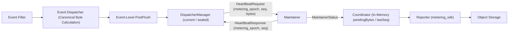

# TiCDC Traffic Metering Design

- Author(s): [3AceShowHand](https://github.com/3AceShowHand)
- Tracking Issue(s): [6204](https://github.com/pingcap/ticdc/issues/6204)

## Background

TiCDC provides per-changefeed replication traffic metering to support usage accounting and usage-based billing.

**Design Goals**:

- **Deterministic, protocol- and sink-independent metering**: identical logical data changes produce the same metered bytes across different encoding protocols and downstream sink types.
- **Lightweight cross-node aggregation with clear fault boundaries**: piggyback on existing control-plane heartbeats without adding new RPCs or etcd metadata persistence overhead.
- **Controlled object storage request cost**: merge per-cycle records into a single upload per minute to avoid request amplification and small-file proliferation across many keyspaces and changefeeds.

The end-to-end pipeline consists of three stages (**Metering Collection → Cross-Node Aggregation → Object Storage Reporting**), illustrated below:



The sections below describe each stage along this data flow in order.

---

## Design Details

### Metering Definition and Collection

#### 1. Definition of `effective_bytes` and Canonical Byte Rules

`effective_bytes` represents the volume of effective logical data bytes replicated by a changefeed to the downstream sink. In the current version, only DML traffic is measured; DDL traffic will be added as a separate field once a suitable measurement definition is established.

Row-level metering sums the applicable logical row images:

- **Row images**: `Insert` meters the new row; `Delete` meters the old row; `Update` meters both the old row and the new row.
- **Column filtering (`column-selectors`)**: for sinks where `column-selectors` apply (such as Kafka, Pulsar, and Cloud Storage), filtered-out columns are excluded from metering; MySQL sinks ignore `column-selectors` and meter all table columns.

Per-column byte counts are computed from decoded logical values, independent of wire encoding formats or downstream protocols:

| SQL Type | Rule | Bytes |
| --- | --- | --- |
| Any `NULL` | Fixed overhead for null values | `1` |
| `TINYINT` / `SMALLINT` / `INT24` / `INT` / `BIGINT` | Fixed integer width, ignoring `UNSIGNED` and display width | `1` / `2` / `3` / `4` / `8` |
| `FLOAT` / `DOUBLE` | Fixed floating-point width, ignoring precision modifiers | `4` / `8` |
| `YEAR` / `DATE` / `TIME` / `DATETIME` / `TIMESTAMP` | Fixed temporal width, ignoring FSP | `2` / `4` / `8` / `8` / `8` |
| `CHAR` / `VARCHAR` / `TEXT` family | Actual UTF-8 text length without padding or space trimming | Actual byte length |
| `BINARY` / `VARBINARY` / `BLOB` family | Actual binary length, preserving existing trailing `0x00` bytes in fixed-length binary columns | Actual byte length |
| `DECIMAL` | Compact byte length of the normalized decimal value | Normalized byte length |
| `BIT` | Minimum big-endian bytes after stripping leading zero bytes, at least `1` byte for zero | `max(1, trimmed bytes)` |
| `JSON` | Binary JSON payload length excluding the root type tag | Payload byte length |
| `ENUM` / `SET` | UTF-8 length of the active name string; empty names count as `0` | Name byte length |
| `VECTOR` (`float32`) | Computed by element count without dimension headers | `4 × elements` |

These per-value rules remain backward-stable across dependency upgrades so identical input data yields identical byte counts across versions.

#### 2. Collection Point and Confirmation Boundary

Metering executes at the common event dispatching layer without intruding into codecs or sink-specific SQL builders:

1. In the event dispatching layer, before an event is enqueued to the downstream sink (and after sink-agnostic processing such as event filtering and column pruning), `effective_bytes` is computed for the DML event using the rules above.
2. Event-level `PostFlush` serves as the confirmation boundary. Following the principle that any data event confirmed as replicated is metered, `PostFlush` adds the event's byte count into the owning `DispatcherManager`'s in-memory counter `current`.
3. Downstream batch merging or cancellation, safe-mode rewrites, MQ message splitting, and compression do not alter an event's metered size; MQ sinks likewise do not meter at individual message-callback granularity.
4. Metering covers all regular sinks as well as `blackhole` and MySQL DryRun mode for testing, but excludes `redo` to avoid double-counting writes before downstream replication.

---

### Cross-Node Aggregation and Failure Recovery

#### 1. In-Memory State Model

Coordinator maintains only two runtime fields per changefeed in memory, without modifying or persisting metering state in etcd:

- **`pendingBytes`**: incremental bytes accumulated since the last successful object storage upload that have not yet been reported.
- **`lastSeq`**: monotonically increasing round sequence number within the current Coordinator term.

Lifecycle semantics are as follows:

- **Pause and resume**: pausing preserves in-memory `pendingBytes` until cleared by the next whole-minute upload (paused changefeeds with zero delta are skipped); resuming continues normal metering and reporting.
- **Deletion**: when a changefeed is deleted, sequence tracking for that instance is removed while any remaining unreported `pendingBytes > 0` stays in memory to be included in the next periodic upload or shutdown flush and cleared upon commit.
- **Existing changefeeds**: existing changefeeds automatically participate starting from `0` after upgrade without backfilling historical traffic.

#### 2. Heartbeat Reuse and Cumulative Acknowledgment Protocol

Cross-node aggregation reuses existing control-plane heartbeat messages without adding new RPCs. Sealing and cumulative acknowledgment are coordinated using `metering_epoch` and `metering_seq`:

- **`metering_epoch`**: identifies the Coordinator term (reusing the monotonically increasing owner revision from leader election). It distinguishes Coordinator terms and fences stale leaders so that when a new Coordinator takes over and resets its in-memory round sequence, surviving `DispatcherManager` instances do not reject the new Coordinator's instructions as stale.
- **`metering_seq`**: identifies the per-changefeed aggregation round within a Coordinator term (starting from `1` and increasing monotonically), enabling idempotent deduplication and cumulative acknowledgment across heartbeat retries and Maintainer failovers.

The protocol operates as follows:

1. **Maintainer → DispatcherManager**: `HeartBeatResponse` (already fenced by `maintainer_epoch`) carries `metering_epoch` and target `metering_seq` (`lastSeq + 1`), indicating that all rounds earlier than `metering_seq` in the same epoch have been aggregated and instructing the node to seal and report the current round.
2. **DispatcherManager local sealing state machine**: each `DispatcherManager` maintains four unsigned integers—`current`, `sealedEpoch`, `sealedSeq`, and `sealedBytes`:
   - On receiving a strictly higher `(metering_epoch, metering_seq)`, atomically swap `current` to `0` into `sealedBytes` and update `sealedEpoch` and `sealedSeq`.
   - On receiving the same `(metering_epoch, metering_seq)`, idempotently resend `(sealedEpoch, sealedSeq, sealedBytes)`.
   - On receiving an older `(metering_epoch, metering_seq)`, ignore it.
3. **DispatcherManager → Maintainer**: `HeartBeatRequest` carries `metering_epoch`, `metering_seq`, and `metering_bytes`.
4. **Maintainer → Coordinator**: after collecting and summing contributions from all active metering-capable `DispatcherManager` instances for the round, Maintainer reports `(metering_epoch, metering_seq, delta_bytes)` via `MaintainerStatus`. Coordinator verifies `maintainer_epoch`, confirms `metering_epoch` matches its current term and `seq == lastSeq + 1`, and then updates `pendingBytes += delta_bytes` and `lastSeq` in memory.

#### 3. Failure Recovery and Rolling Upgrade

- **Maintainer crash or migration (Coordinator alive)**: Coordinator retains `lastSeq` and `pendingBytes` in memory, and the new or migrated Maintainer inherits `(metering_epoch, lastSeq)` to realign with surviving `DispatcherManager` nodes. If the crash occurred before Coordinator accepted the round, DMs resend `sealedBytes` (zero loss); if it occurred after acceptance, the new Maintainer requests the next sequence and DMs discard the already-accepted snapshot and seal newly flushed traffic (zero double-counting).
- **DispatcherManager node crash or restart**: the restarted node starts from zero state and Maintainer removes the lost node from the active round. Events on the crashed node that were not yet confirmed at the checkpoint are resynchronized after rescheduling and metered normally upon confirmation, while the bytes flushed since that node's last seal, and any sealed snapshot the Maintainer has not yet received, are discarded; `defaultMeteringRoundInterval` delays the next round after an acknowledgment and does not bound how long a stalled round remains open.
- **Transient object storage failures or object conflicts**: Coordinator retains in-memory `pendingBytes` without deducting it; if a failed write already attempted storage `PUT` with an unknown outcome, Coordinator checks the object's existence before the next upload—committing the prior batch if persisted or merging it into the next whole-minute upload otherwise—guaranteeing zero loss and preventing cross-minute duplication.
- **Graceful shutdown, failover, and rolling upgrade**: before stepping down or exiting, Coordinator flushes unreported in-memory deltas to the next unused whole minute. The newly elected Coordinator holds a strictly greater `metering_epoch` and immediately advances sealing from sequence `1` of the new epoch across surviving `DispatcherManager` nodes without being blocked by prior `sealedSeq` values; any prior-term `sealedBytes` not yet absorbed before epoch switch—as well as the trailing unsealed round during changefeed deletion or close—are discarded on purpose rather than carried across epochs or blocking deletion, guaranteeing zero double-counting.
- **Unexpected Coordinator crash**: an abrupt process termination or host outage loses all unreported in-memory `pendingBytes` accumulated since the last successful upload (typically `< 60` seconds under healthy object storage, or the full unuploaded window during prolonged storage outages); the newly elected Coordinator resumes seamlessly with a higher `metering_epoch`.
- **Mixed-version rolling upgrade**: normal rolling upgrades upgrade the Coordinator node last. `DispatcherManager` nodes advertise metering capability during handshake and heartbeats; when advancing `metering_seq`, Maintainer waits only for capable nodes and skips un-upgraded nodes until they are upgraded and naturally join subsequent rounds.

---

### Object Storage Reporting and Configuration

#### 1. Enablement and Configuration

Traffic metering is configured statically across the cluster and is enabled whenever `[metering]` specifies a non-empty storage `type`, without deployment-mode gates or dynamic control-plane toggles. Example TOML configuration:

```toml
[metering]
type = "s3"
region = "us-west-2"
bucket = "my-metering-bucket"
prefix = "prod"
endpoint = "https://s3.us-west-2.amazonaws.com"
shared-pool-id = "1234567890123456789"

[metering.aws]
assume-role-arn = "arn:aws:iam::123456789012:role/ticdc-metering"
```

#### 2. Storage Path and Data Format

During its term, Coordinator uploads per-minute **incremental traffic deltas** for each changefeed to object storage via the Metering SDK (`github.com/pingcap/metering_sdk`), leaving final cumulative summation over time windows to the downstream billing system.

- **Object path and topology mapping**: `<prefix>/metering/ru/<minute-unix>/ticdc/<shared_pool_id>/<self_id>-<part>.json.gz`, where `shared_pool_id` maps to the physical cluster ID, `cluster_id` in `data[]` maps to the logical cluster ID (`keyspace_name`), and `changefeed` maps to the globally unique internal changefeed name.
- **File grouping and `self_id`**: `self_id` is derived by replacing `-` with `_` in the cluster's `cluster-id`, satisfying the SDK's path-identifier constraints. Because `cluster-id` defaults to `default`, multiple TiCDC clusters sharing the same `bucket`, `prefix`, and `shared_pool_id` must configure distinct `cluster-id` values to avoid object-name collisions. Each cycle merges all changefeeds with non-zero deltas across the cluster into a single object, avoiding timeouts and small-file explosion across many keyspaces.
- **Overwrite protection and pagination**: overwrite within the same minute is disabled (`OverwriteExisting = false`) so retries or overlapping failover writes cannot clobber a previously uploaded delta; if an existing-file conflict occurs, in-memory deltas are preserved and merged into the next whole-minute upload. Single-cycle pagination is disabled by default (one file per minute), while multi-`-part` splitting across `data[]` elements remains supported. The configured `prefix` is passed through directly to the Metering SDK.
- **Flat record schema**: `data[]` uses a flat schema where each entry represents one changefeed without redundant fixed category labels or internal UUIDs:

```json
{
  "timestamp": 1788912000,
  "category": "ticdc",
  "self_id": "default",
  "shared_pool_id": "1234567890123456789",
  "part": 0,
  "data": [
    {
      "version": "1",
      "cluster_id": "12345678901234567890",
      "changefeed": "changefeed-2035974607254523904",
      "effective_bytes": {
        "value": 104857600,
        "unit": "Bytes"
      }
    },
    {
      "version": "1",
      "cluster_id": "12345678901234567890",
      "changefeed": "changefeed-2035974607254523905",
      "effective_bytes": {
        "value": 20480,
        "unit": "Bytes"
      }
    }
  ]
}
```

#### 3. Reporting Schedule and Graceful Shutdown

- **Whole-minute scheduling and retries**: Coordinator runs a single background reporting loop on a fixed 60-second schedule aligned to whole-minute timestamps, advancing to the next whole minute each cycle. Only changefeeds with pending delta `> 0` are included; if the entire cluster has zero pending delta, the upload is skipped. At most one upload runs at a time and missed cycles are not caught up in bursts; each upload attempt has a 10-second timeout with up to 3 total attempts (1s and 2s retry backoff).
- **Snapshot deduction and failure retention**: before uploading, Coordinator snapshots positive `pendingBytes`; upon success, it deducts only the uploaded snapshot (preserving concurrent heartbeat increments accumulated during upload) and removes entries whose balance drops to zero. On upload failure or file conflict, in-memory `pendingBytes` is retained intact for the next cycle.
- **Best-effort final delta on deletion**: deleting a changefeed releases its sequence state while retaining any unreported `pendingBytes` in memory without I/O, keeping external delete operations non-blocking and avoiding extra small-file writes; these balances are merged into the next whole-minute upload or shutdown flush.
- **Graceful shutdown budget**: on exit, Coordinator cancels any in-flight periodic upload and performs a final synchronous flush of unreported `pendingBytes` to the **next unused whole-minute timestamp** under an independent 10-second timeout before closing the reporter client, keeping shutdown within the global 30-second graceful shutdown budget.

---

### Benefits

1. **Complete decoupling from protocols and sinks**: metering at the sink-agnostic event dispatching layer with event-level `PostFlush` confirmation avoids touching encoders or downstream SQL builders and remains invariant to batching and compression.
2. **Simple, accurate cross-node aggregation**: reusing existing heartbeats with `(metering_epoch, metering_seq)` achieves sealing and cumulative acknowledgment with zero new RPCs, avoiding double-counting and data loss while enabling fast failover recovery.
3. **Zero metadata intrusion and minimal storage cost**: pure in-memory aggregation combined with per-minute single-file delta uploads leaves etcd untouched, avoids metadata downgrade burdens, and keeps cluster-wide object storage writes down to one request per minute.

---

### Follow-up Work

- **Avoid re-submitting a batch whose previous upload may have succeeded.** `Reporter.write` returns success when a retry observes `ErrFileExists`, but if an earlier attempt stored the object and every later attempt fails before that check, `Report` returns an error and `reportAt` keeps the snapshot in `pendingBytes`; the next whole-minute upload then stores the same bytes under a later timestamp. Decide how a retry identifies the earlier batch, for example through the object path or payload, and whether an unprovable outcome favors duplicate counting or loss.
- **Clear `roundBytes` when an ACK advances `targetSeq`.** `meteringCollector.OnAck` sets `targetSeq = ackedSeq + 1` without clearing `roundBytes`. `meteringAccumulator.Accept` answers a stale sequence with the latest accepted sequence, so a Maintainer that starts from an older `MeteringLastSeq` can receive an ACK ahead of its target while `roundBytes` still holds entries recorded for the old target; the next completed round reuses those entries and the Coordinator counts the same bytes twice. Clear `roundBytes` and reset `roundStartedAt` whenever the ACK advances the target, and cover a stale `MeteringLastSeq` in a test.
- **State the shutdown flush guarantee.** `FlushOnShutdown` advances the timestamp only on `ErrFileExists`, stops on any other error, and gives up after five attempts within `meteringShutdownFlushTimeout`; when it stops, the buffered bytes are lost as the Coordinator exits. Either document the final flush as best-effort or keep retrying transient failures until the timeout.
